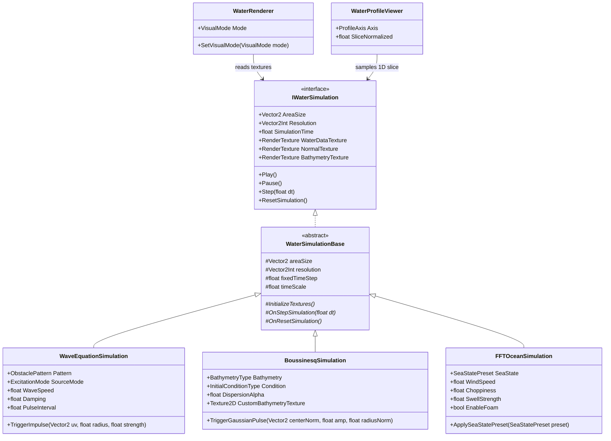

# Unity Water Simulation 実装・技術検討・議論アーカイブ総合資料

本資料は、[`com.nobnak.water-simulation`](../Packages/com.nobnak.water-simulation/package.json)（v0.1.0）の Git コミット履歴・コードベース実装仕様と、Antigravity 1.0 (IDE) の全2セッション（計13ターン）で実施された技術議論・数値発散の原因調査・設計判断・次期拡張ロードマップを漏れなく体系化したリファレンス資料です。

---

## 1. セッション・コミット全体像

### 1.1 Antigravity 1.0 (IDE) セッション一覧

| セッションID | 期間 (JST) | ステップ数 | ターン数 | 主な内容 |
| :--- | :--- | :---: | :---: | :--- |
| `a86b2a57-1d29-4f49-85f0-ba4e54baacd7` | 2026-10-26 14:27 〜 10-27 17:56 | 1,669 | 12 | パッケージ初期実装、入力系修正、Boussinesq数値安定化、描画モード修正、UI拡充、パルス波源化、不要コード掃除、および今後の拡張設計（LOD・自由境界・02シーン拡張） |
| `c95e553c-8ef9-4ea9-bd31-e34bfc91280f` | 2026-10-27 20:25 〜 10-27 20:27 | 44 | 1 | コミット履歴およびモジュール別の実装到達度調査 |

### 1.2 Gitコミット履歴との対応

| コミット | 日時 (JST) | 種別 | 対応ターン | 概要 |
| :--- | :--- | :---: | :---: | :--- |
| [`ad63e8b`](../.gitignore) | 10/26 14:25 | `init` | - | 初回コミット（`.gitignore`） |
| [`7c392cc`](../Packages/com.nobnak.water-simulation/package.json) | 10/27 12:12 | `feat` | Turn 1〜2 | 3方式の水面シミュレーションモデル、5サンプルシーン、New Input System 対応の一括追加 |
| [`484f35f`](../Packages/com.nobnak.water-simulation/Runtime/Boussinesq/Boussinesq.compute) | 10/27 13:17 | `fix` | Turn 3〜4 | Boussinesq の MacCormack スキームおよび進行波ソース造波による数値安定化 |
| [`655ecfa`](../Packages/com.nobnak.water-simulation/Runtime/Shaders/WaterSurfaceCommon.shader) | 10/27 14:08 | `fix` | Turn 5〜6 | Uniform 動的分岐によるリアルタイム描画モード切り替えの有効化 |
| [`fa78e4d`](../Packages/com.nobnak.water-simulation/Runtime/Common/WaterSampleUI.cs) | 10/27 15:29 | `feat` | Turn 7〜9 | 障害物・波源励起・物理パラメータの対話的 UI コントロール追加 |
| [`45f486d`](../Packages/com.nobnak.water-simulation/Runtime/WaveEquation/WaveEquationSimulation.cs) | 10/27 15:59 | `feat` | Turn 10 | 2D波動方程式における固定持続時間・周期インターバル制御パルス発生器の実装 |
| [`56a6495`](../Packages/com.nobnak.water-simulation/Runtime/FFTWater/FFTOcean.compute) | 10/27 16:24 | `chore` | Turn 11 | 未使用オシレータフィールド・廃止カーネルの削除および FFT コンピュートインデックス計算の最適化 |

---

## 2. アーキテクチャと共通データ規格

### 2.1 クラス階層とコンポーネント構成

### 2.2 出力 RenderTexture フォーマット規格 ([`IWaterSimulation.cs`](../Packages/com.nobnak.water-simulation/Runtime/Common/IWaterSimulation.cs))

- **座標系・単位**: ワールド座標系（XZ水平面、+Y鉛直上向き）、SI単位系（m, s）、静止基準水位 $y = 0$。

| テクスチャ名 | フォーマット | R チャンネル | G チャンネル | B チャンネル | A チャンネル |
| :--- | :---: | :--- | :--- | :--- | :--- |
| **`WaterDataTexture`** (`_WaterDataTex`) | `ARGBHalf` | 水平X変位 $\Delta x$ [m] | 鉛直変位（波高） $\eta$ [m] | 水平Z変位 $\Delta z$ [m] | 白波・泡強度 $\text{Foam} \in [0, 1]$ |
| **`NormalTexture`** (`_NormalTex`) | `ARGBHalf` | 法線 $N_x$ | 法線 $N_y$ | 法線 $N_z$ | 白波・泡強度 $\text{Foam} \in [0, 1]$ |
| **`BathymetryTexture`** (`_BathymetryTex`) | `RGHalf` | 静水深 $h(\mathbf{x})$ [m] | 水底標高 $z_b = -h(\mathbf{x})$ [m] | - | - |

---

## 3. 実装・解決済みの議論と数理仕様詳細（Turn 1〜11, 13）

### 3.1 初期設計・3方式UPMパッケージの構築（Turn 1 / コミット `7c392cc`）

- **確定環境**: Unity 6 (`6000.3.27f1`), URP `17.3.0`, Compute Shader 5.0+, Intel(R) Arc(TM) 140V GPU (16 GB VRAM)。

#### 各方式の実装と性能ベンチマーク（1280×720）

| 方式・サンプルシーン | 実装クラス / シェーダー | 物理・数値モデル | 格子数 / 内部 $dt$ | GPU時間 / FPS |
| :--- | :--- | :--- | :---: | :---: |
| **01_WaveEquation** 「波紋と障害物」 | [`WaveEquationSimulation.cs`](../Packages/com.nobnak.water-simulation/Runtime/WaveEquation/WaveEquationSimulation.cs) [`WaveEquation.compute`](../Packages/com.nobnak.water-simulation/Runtime/WaveEquation/WaveEquation.compute) | 9点等方性ラプラシアンFDM＋半陰的減衰Leapfrog時間積分、CFL自動サブステップ、外周スポンジ吸収層、スリット障害物マスク | $256^2$ / $0.003\text{ s}$ $512^2$ / $0.0015\text{ s}$ | $0.15\text{ ms}$ / $140+$ $0.38\text{ ms}$ / $120+$ |
| **02_Boussinesq** 「浅瀬と岬」 | [`BoussinesqSimulation.cs`](../Packages/com.nobnak.water-simulation/Runtime/Boussinesq/BoussinesqSimulation.cs) [`Boussinesq.compute`](../Packages/com.nobnak.water-simulation/Runtime/Boussinesq/Boussinesq.compute) | Peregrine (1967) 弱非線形・弱分散浅水波モデル、MacCormack予測子・修正子法、4パスJacobi緩和によるHelmholtz分散インバータ $(I - \beta\nabla^2)\mathbf{a} = \mathbf{f}$ | $256^2$ / $0.016\text{ s}$ $512^2$ / $0.008\text{ s}$ | $0.42\text{ ms}$ / $120+$ $1.15\text{ ms}$ / $95+$ |
| **03_FFTWater** 「水平線までの海」 | [`FFTOceanSimulation.cs`](../Packages/com.nobnak.water-simulation/Runtime/FFTWater/FFTOceanSimulation.cs) [`FFTOcean.compute`](../Packages/com.nobnak.water-simulation/Runtime/FFTWater/FFTOcean.compute) | Tessendorf (2001) Phillipsスペクトル＋独立うねり（Swell）、Radix-2 Stockham 2D IFFT（Height $D_y$・Choppy $(D_x,D_z)$ の計2回）、ヤコビアン白波 | $256^2$ / $0.033\text{ s}$ $512^2$ / $0.033\text{ s}$ | $0.35\text{ ms}$ / $130+$ $0.95\text{ ms}$ / $105+$ |
| **04_Comparison_Dispersion** | [`WaterComparisonController.cs`](../Packages/com.nobnak.water-simulation/Runtime/Common/WaterComparisonController.cs) [`WaterProfileViewer.cs`](../Packages/com.nobnak.water-simulation/Runtime/Common/WaterProfileViewer.cs) | 一定水深（5m）・同振幅ガウスパルスからの伝播比較（非分散の単一波形維持 vs Boussinesqの周波数分散波列テール） | $256^2 \times 2$ | $115+\text{ FPS}$ |
| **05_Comparison_Overview** | 同上 | 3方式の横並び一括同期実行・比較ステージ | $256^2 \times 3$ | $0.92\text{ ms}$ / $110+$ |

#### シェーダーカーネル構成と離散化数式（確定仕様）
- **2D波動方程式 ([`WaveEquation.compute`](../Packages/com.nobnak.water-simulation/Runtime/WaveEquation/WaveEquation.compute))**:
  - **9点等方性ラプラシアン**:
    $$\nabla^2 \eta \approx \frac{4(\eta_L + \eta_R + \eta_D + \eta_U) + (\eta_{LD} + \eta_{RD} + \eta_{LU} + \eta_{RU}) - 20\eta_C}{6\Delta x^2}$$
  - **半陰的減衰 Leapfrog スキーム**:
    $$\eta^{n+1} = \frac{2\eta^n - \eta^{n-1}(1 - \frac{1}{2}\gamma\Delta t) + c^2\Delta t^2 \nabla^2\eta^n}{1 + \frac{1}{2}\gamma\Delta t}$$
  - **インパルス注入 (`CSAddImpulse`)**: 現在変位 `state.r` と前ステップ変位 `state.g` の双方に同一ガウス分布 $A\exp(-3(r/R)^2)$ を加算し、初速 $0$ の純粋な初期変位として励起。
- **Boussinesq系 ([`Boussinesq.compute`](../Packages/com.nobnak.water-simulation/Runtime/Boussinesq/Boussinesq.compute))**:
  - **5カーネル構成**: `CSPredict`（右・上との前進差分）→ `CSCorrect`（左・下との後退差分＋平均）→ `CSJacobiStep`（4反復、$\beta = \operatorname{clamp}(\alpha h^2 / (6\Delta x^2), 0, 4)$）→ `CSApplyDispersion` → `CSComputeNormal`。
  - **進行波ソース造波 (`GetWavemakerSources`)**: ガウス幅 $\sigma = 2.5\Delta x$ で質量ソース $S_\eta = c W$ と運動量ソース $S_w = g W$（$c = \sqrt{gh}$）を同時注入し、両端スポンジ層への干渉を防ぐ横方向テーパー `smoothstep(0, _SpongeWidth * 1.5, lateralDist)` を適用。
- **FFT海面 ([`FFTOcean.compute`](../Packages/com.nobnak.water-simulation/Runtime/FFTWater/FFTOcean.compute))**:
  - **5カーネル構成**: `CSGenerateSpectrum` → `CSTimeEvolution` → `CSFFTHorizontal` ($\log_2 N$ 段) → `CSFFTVertical` ($\log_2 N$ 段) → `CSPackOceanData`。

#### 代表シーン検証キャプチャ

| シーン | キャプチャ画像 |
| :--- | :--- |
| **01_WaveEquation** |  |
| **02_Boussinesq** |  |
| **03_FFTWater** |  |
| **04_Comparison_Dispersion** |  |
| **05_Comparison_Overview** |  |

---

### 3.2 パッケージ依存関係の精査と New Input System 対応（Turn 2 / コミット `7c392cc`）

- **課題**:
  1. エディタ上で Deprecated なパッケージが見えたため不要パッケージ混入の調査依頼。
  2. `01_WaveEquation` 起動時に `SimpleCameraController.HandleInput()` で `InvalidOperationException`（New Input System 環境下での旧 `UnityEngine.Input` 呼び出し）が発生。
- **調査結果と対応**:
  1. パッケージ側（[`package.json`](../Packages/com.nobnak.water-simulation/package.json)）の依存は `com.unity.mathematics`, `com.unity.render-pipelines.universal`, `com.unity.inputsystem` の3点のみでクリーンであることを確認。プロジェクト側の [`Packages/manifest.json`](../Packages/manifest.json) にある URP テンプレート初期パッケージ（`com.unity.ai.assistant`, `com.unity.ai.inference`, `com.unity.visualscripting` 等）の要否一覧を整理。
  2. [`SimpleCameraController.cs`](../Packages/com.nobnak.water-simulation/Runtime/Common/SimpleCameraController.cs) および [`WaveEquationSimulation.cs`](../Packages/com.nobnak.water-simulation/Runtime/WaveEquation/WaveEquationSimulation.cs) に `#if ENABLE_INPUT_SYSTEM` 分岐を実装し、`Mouse.current` / `Keyboard.current` によるカメラ操作と水面クリック波源入力に対応（旧 Input Manager 環境へのフォールバックも維持）。

---

### 3.3 `02_Boussinesq` の数値発散原因調査と MacCormack 法による安定化（Turn 3〜4 / コミット `484f35f`）

#### 発散を引き起こしていた5つの要因（Turn 3）
1. **前進オイラー法（FTCS）の無条件不安定性【主因】**:
   双曲型浅水波系に対する前進時間差分＋中心空間差分は、フォン・ノイマン安定性解析において増幅係数 $|G(k)|^2 = 1 + \left(c \frac{\Delta t}{\Delta x} \sin(k\Delta x)\right)^2 > 1$ となり、CFL条件に関わらず高周波成分が指数関数的に増大しクランプ限界（$\pm 10\text{ m}$）に張り付いて矩形波発振を起こしていた。
2. **コロケート格子（Arakawa A-grid）の奇偶デカップリング（市松模様ノイズ）**:
   水位 $\eta$ と流速 $(u, w)$ を同一格子点に定義し中心差分をとるため、波長 $2\Delta x$ の交互ノイズ（$+1, -1, +1, -1$）に対する勾配が $0$ となり減衰しなかった。
3. **非線形移流項 $(\mathbf{u}\cdot\nabla)\mathbf{u}$ の風上化なし中心差分**:
   急勾配部で非線形エイリアシングにより最小格子スケールへエネルギーが集中。
4. **造波帯の強制 Dirichlet 上書き（`state.r = wave`）による段差ショック**:
   浅瀬から戻ってきた反射波が造波ラインで剛体壁のように再反射し、不連続段差から高周波ノイズが連続発生。
5. **深水部での Helmholtz 分散項 $\beta = \frac{\alpha h^2}{6\Delta x^2}$ の過大化**:
   4回の Jacobi 反復では深水部（$h=15\text{ m}$）の残差が収束しきらず位相ズレを生んでいた。

#### 方針比較と実装内容（Turn 4）
MacCormack法（方針A）、RK2＋4階超粘性（方針B）、スタガードC-grid化（方針C）を比較し、既存の ping-pong 構造を活かしつつ2階精度と適度な高周波減衰を両立する **方針A（MacCormack 予測子・修正子法）** を採用・実装：
- [`Boussinesq.compute`](../Packages/com.nobnak.water-simulation/Runtime/Boussinesq/Boussinesq.compute):
  - **`CSPredict`（前進差分）＋`CSCorrect`（後退差分平均）**: 前進・後退差分の誤差相殺により $|G| \le 1$ となり、$2\Delta x$ の市松模様ノイズが自然消滅。
  - **進行波内部ソース造波**: リーマン不変量に基づき質量ソース $S_\eta$ と前進運動量ソース $S_w = \sqrt{g/h}S_\eta$ をガウシアン帯に同時加算し、反射波を透過させつつ $+z$ 方向へクリーンな進行波を生成。
  - **外周スポンジ帯での水位 $\eta$ 緩和**および分散パラメータ $\beta$ の安全クランプを追加。
- [`BoussinesqSimulation.cs`](../Packages/com.nobnak.water-simulation/Runtime/Boussinesq/BoussinesqSimulation.cs): 予測ステップ用の中間テクスチャ `predTex` を分離し GPU スレッド間の競合（Race Condition）を排除。

---

### 3.4 波面ハイライトの仕組みと描画モード切り替え不具合の修正（Turn 5〜6 / コミット `655ecfa`）

#### 波面の白いハイライト要因（Turn 5）
[`WaterSurfaceCommon.shader`](../Packages/com.nobnak.water-simulation/Runtime/Shaders/WaterSurfaceCommon.shader) における波面の色は以下の3要素の合成であることを整理：
1. **水面下地色（Diffuse）**: 水位 $\eta$ に応じた濃紺（波の谷 `_DeepColor`）〜エメラルドシアン（波の峰 `_BaseColor`）のグラデーション。
2. **鏡面反射（Specular）**: 法線傾斜と太陽光（Directional Light）による Blinn-Phong ハイライト（`pow(nDotH, 64) * _Smoothness`）。
3. **白波表現（Foam）**: 波面の傾斜勾配（$|\nabla \eta| > 0.15$）または FFT ヤコビアンで検出された泡色（`_FoamColor`）のブレンド。

#### 描画モード切り替え不具合の修正（Turn 6）
- **原因**: シェーダー側が `#pragma shader_feature_local` のコンパイル時マクロ（`#if defined(_VISUALMODE_*)`）で分岐していた一方、[`WaterRenderer.cs`](../Packages/com.nobnak.water-simulation/Runtime/Common/WaterRenderer.cs) は実行時に `MaterialPropertyBlock.SetFloat("_VisualMode", ...)` で数値を送っていたため、キーワードが切り替わっていなかった。
- **修正**: [`WaterSurfaceCommon.shader`](../Packages/com.nobnak.water-simulation/Runtime/Shaders/WaterSurfaceCommon.shader) のフラグメントシェーダーを CBUFFER の `_VisualMode` に基づく Uniform 動的分岐（`0: Realistic`, `1: HeightMap`, `2: Normal`, `3: Wireframe`）へ変更し、UI に `Wireframe` ボタンを追加。

| モード | キャプチャ画像 |
| :--- | :--- |
| **Realistic (`0`)** |  |
| **HeightMap (`1`)** |  |
| **Normal (`2`)** |  |
| **Wireframe (`3`)** |  |

---

### 3.5 `01_WaveEquation` の不可視障害物と画面UIコントロールの拡充（Turn 7〜9 / コミット `fa78e4d`）

- **不可視障害物の理由（Turn 7）**:
  `01_WaveEquation` シーン中央の反射は、波の回折・干渉を観察するための二重スリットマスク（`_ObstacleTex` の `ObstaclePattern.DoubleSlit`）であり、水面メッシュのみを描画し壁の3Dオブジェクトを置いていなかったため透明な壁として見えていたことを説明。
- **画面内 HUD コントロールの実装（Turn 8〜9）**:
  当初テキスト説明のみだった [`WaterSampleUI.cs`](../Packages/com.nobnak.water-simulation/Runtime/Common/WaterSampleUI.cs) に `DrawSpecializedControls()` を実装し、各方式固有のパラメータを画面上で直接操作可能にした：
  - **01 WaveEquation**: スリット/障害物切替（`None`, `Single`, `Double`, `Pillars`）、波源モード切替（`Impulse`, `Oscillator`, `Moving`, `Mouse`）、`Trigger Impulse` ボタン、`WaveSpeed` / `Damping` スライダー。
  - **02 Boussinesq**: 海底地形切替（`Flat`, `Shoal`, `Slope`）、波源切替（`Wavemaker`, `Pulse`）、`Dispersion` / `Wave Amp` スライダー。
  - **03 FFTWater**: 海況プリセット切替（`Calm`, `Swell`, `Stormy`）、`Wind` / `Choppy` / `Swell` スライダー、`Foam` トグル。

---

### 3.6 周期的固定幅インパルス波源への改修とコードベース全体のクリーンアップ（Turn 10〜11 / コミット `45f486d`, `56a6495`）

- **周期的パルス波源（Turn 10 / コミット `45f486d`）**:
  - **課題**: `ContinuousOscillator` が正弦波 $\sin(2\pi f t)$ で常時励起していたため、周波数を下げると1回あたりの隆起時間（半周期 $1/(2f)$）まで間延びし、波長 $\lambda = c/f$ が巨大化して波面全体が鈍い山のように上下し、スリット干渉縞がぼやけていた。
  - **解決**: 1回あたりの波紋の太さは `sourceRadius` で決まるシャープなガウスインパルス（`TriggerImpulseOnTarget`）に固定し、発生間隔のみを `PulseInterval`（$0.2\text{ s} \sim 3.0\text{ s}$）で制御する水滴モデルに変更。

- **警告 `CS0414` 解消と不要コード一掃（Turn 11 / コミット `56a6495`）**:
  - [`WaveEquationSimulation.cs`](../Packages/com.nobnak.water-simulation/Runtime/WaveEquation/WaveEquationSimulation.cs) / [`WaveEquation.compute`](../Packages/com.nobnak.water-simulation/Runtime/WaveEquation/WaveEquation.compute): 未使用となった `oscillatorPhase`、`kernelOscillator`、`CSAddOscillator` カーネル、`_PreviousState` 等を削除。
  - [`WaterSurfaceCommon.shader`](../Packages/com.nobnak.water-simulation/Runtime/Shaders/WaterSurfaceCommon.shader): `_VisualMode` の `[KeywordEnum]` を `[Enum(...)]` に変更し不要なキーワードバリアントを排除。
  - [`FFTOcean.compute`](../Packages/com.nobnak.water-simulation/Runtime/FFTWater/FFTOcean.compute): 未使用定数（`_LengthScale2`, `_PassIndex`, `_NumStages`）を削除し、符号付き整数除算・剰余（`/`, `%`）を `uint` ビットシフトとビットマスク `& (R - 1u)` / `& (N - 1)` に置換して D3D11 コンパイラ警告を解消。
  - [`BoussinesqSimulation.cs`](../Packages/com.nobnak.water-simulation/Runtime/Boussinesq/BoussinesqSimulation.cs): 未参照だった `customBathymetryTexture` に `CustomBathymetryTexture` プロパティと `UpdateBathymetryTexture()` 内のバイリニアサンプリング処理を接続。

---

## 4. 技術検討・設計提案済みで未着手のテーマ（計3件）

Antigravity 1.0 (IDE) 上で設計・比較検討が完了し、次期実装フェーズへ進める状態にある3つの技術テーマです。

### 4.1 テーマA：`02_Boussinesq` における海底地形の可視化と孤立波バリエーション拡充（Turn 12）

#### 1. 海底地形（Bathymetry）の可視化設計
現在 `02_Boussinesq` は内部で $512 \times 512$ の水深テクスチャ（`_BathymetryTex`: R = 静止水深 $h$, G = 海底標高 $z_b = -h$）を保持しているが、描画側に渡していないため画面上は平坦な水面しか見えない。以下の組み合わせを推奨：

| 可視化アプローチ | 実装内容 | 特徴・効果 |
| :--- | :--- | :--- |
| **A. 水中海底メッシュの描画（推奨）** | 水面下に海底用プレーン（`SeabedRenderer`）を配置し、頂点シェーダーで $z_b$ の深さに変位させ、砂地・岩礁カラーと等高線グリッドで描画。水面の透過越しに浅瀬や岬が立体的に見える。 | 浅瀬や岬の立体形状が水中にはっきり見え、波が浅瀬に差し掛かった瞬間に速度 $c \sim \sqrt{gh}$ が落ちて曲がる物理的理由が直感的にわかる。 |
| **B. 描画モードへの `Bathymetry` 追加** | [`WaterSurfaceCommon.shader`](../Packages/com.nobnak.water-simulation/Runtime/Shaders/WaterSurfaceCommon.shader) に `_BathymetryTex` を接続し、`_VisualMode` に `Bathymetry (4)` を追加。水深分布を等高線ヒートマップとして表示。 | ワンクリックで水深分布と波高マップ（`HeightMap`）を直接見比べられる。 |

#### 2. 孤立波（ソリトン）のGPU非破壊加算化とバリエーション拡充
現在の `TriggerGaussianPulse` は CPU でテクスチャ全体を上書きするため「既存の波が消える」「毎フレーム励起できない」制約がある。これを [`Boussinesq.compute`](../Packages/com.nobnak.water-simulation/Runtime/Boussinesq/Boussinesq.compute) の GPU 加算カーネル（`CSAddImpulse`）へ刷新することで、以下の5つのバリエーションを実現可能：

| バリエーション | 数理モデル・励起方法 | 観察できる Boussinesq 特有の現象 |
| :--- | :--- | :--- |
| **1. 1次元平面孤立波** (Planar Solitary Wave) | $$\eta(y) = A \operatorname{sech}^2\!\left(\sqrt{\frac{3A}{4h^3}}(y - y_0)\right), \quad w(y) = c\frac{\eta}{h + \eta}$$ | 平坦底では波形を保って直進し、斜め浅瀬や岬で波面がハの字に屈折・波高集中（Shoaling）する過程を1波単独で鮮明に観察。 |
| **2. 円形孤立波パルス** (Circular Soliton Ring) | $\eta(r) = A \exp(-3(r/R)^2)$ または $\operatorname{sech}^2$ リング | 深水部と浅水部の伝播速度差により、円形だった波面が浅瀬側で扁平・楕円状に歪みながら屈折する過程を観察。 |
| **3. マウスクリック/ドラッグ励起** (Interactive Mouse Injection) | マウスレイキャスト UV 座標へ GPU でパルスを加算（01シーンと同様） | 浅瀬の真上や岬の背後など任意の位置に波を落とし、地形による屈折・回り込みを対話的に探求。 |
| **4. 周期的孤立波列** (Periodic Pulse Train) | 一定インターバル（例: $1.5\text{ s}$）で平面孤立波または円形パルスを連続射出 | 連続正弦波と異なり波と波の間に静水面間隔があるため、各孤立波の浅水変形を独立して追跡可能。 |
| **5. ソリトン衝突・追尾実験** (Soliton Collision / Dual Pulse) | 大小2つの孤立波（追い抜き）または対向する2つの孤立波（正面衝突）を同時励起 | 非線形ソリトンの特徴である「大振幅ソリトンが小振幅ソリトンを追い抜く／衝突後に波形を保ってすり抜ける」現象の検証。 |

---

### 4.2 テーマB：自由な境界形状（湖畔・島など）の指定（Turn 9）

#### 入力インターフェース案
1. **境界マスク / 距離フィールドテクスチャ（SDF / 2値マスク）**: 水域を `0`、陸地を `1`（または岸からの符号付き距離）とする `Texture2D`。
2. **地形ハイトマップとの交差（Water Level Clipping）**: 地形標高 $H(x, z)$ と基準水面 $Y$ の差から水深 $h(x, z) = Y - H(x, z)$ を算出し、$h \le 0$ を陸地境界とする。

#### 各シミュレーション方式での対応方針

| 方式 | 自由境界の実現性 | 反射・屈折の物理計算 | 実装アプローチ |
| :--- | :---: | :---: | :--- |
| **2D波動方程式** | **完全対応** | ◎ 完全反射・回折・干渉 | 既存の `_ObstacleTex` に任意の湖畔マスクテクスチャをバインドするだけで、任意の岸壁形状での反射・回折がそのまま動作。 |
| **Boussinesq系** | **完全対応** | ◎ 浅水変形・屈折・回り込み | `CustomBathymetryTexture` に湖畔の水深マップを与えることで、岸に向かって波が減速し汀線と平行に波面が揃う物理的屈折が自然に発生。 |
| **FFT海面** | **視覚的対応** | × 壁面反射は不可（周期境界のため） | 沖合の波を FFT で解き、岸からの距離 $dist$ に応じて頂点変位を減衰させる **Shoreline Damping**（$\text{Disp} = \text{Disp}_{\text{FFT}} \times \operatorname{saturate}(dist / \text{fadeDist})$）＋陸地領域のシェーダークリッピング＋汀線フォーム強調で自然な湖畔を表現。 |

---

### 4.3 テーマC：水面メッシュ細分化（LOD）の方式選定（Turn 6）

オープンソースパッケージ `jp.nobnak.heightfield-lod` の導入と独自実装を比較評価した結果、**水面専用の同心リング Geometry Clipmap による独自実装（案B）** を推奨。

| 評価軸 | `jp.nobnak.heightfield-lod` の仕様 | 水面シミュレーションの要求仕様 | 判定・理由 |
| :--- | :--- | :--- | :--- |
| **カメラ投影** | **正射影 (Orthographic)** 前提 | **透視投影 (Perspective)**（斜め見下ろし〜水平線視点） | **不適合**: 遠近法による手前・奥のピクセル密度差に対応できない |
| **LOD 分割基準** | **曲率 (Curvature / Laplacian)** 駆動 | **カメラ距離 (Screen-Space Error)** 駆動 | **特性の相違**: 水面は平坦な領域でも手前なら高密度メッシュが必要 |
| **配置・座標系** | ローカル XY 平面（高さは $-Z$ 方向） | 水平 XZ 平面（高さは $+Y$ 方向） | Transform とシェーダー座標変換のすり合わせが必要 |
| **変位次元** | **1次元スカラー高さ $h$** (`RFloat`) | **3次元変位 $(\Delta x, \eta, \Delta z)$ + Foam** (`RGBAHalf`) | **変位欠落**: FFT 海面の水平 Choppy 変位（尖った波頭）が扱えない |
| **パッケージ依存** | OpenUPM Scoped Registry の追加が必要 | 単体で完結し即座にインポート・実行可能 | 外部レジストリ依存を増やさない方が配布品質が高い |

> [!TIP]
> **推奨される Geometry Clipmap 設計（案B）**:
> カメラの水平位置を中心として解像度が倍々で広がる $4\sim 6$ 段階の同心グリッドリングを配置し、テクセルサイズ単位でグリッド位置をスナップ（Texel Snapping）させることで、カメラ移動時の頂点ジッター（Swimming 現象）を防ぎつつ手前のリップルから水平線まで最小頂点数で3方式すべてを描画できる。
