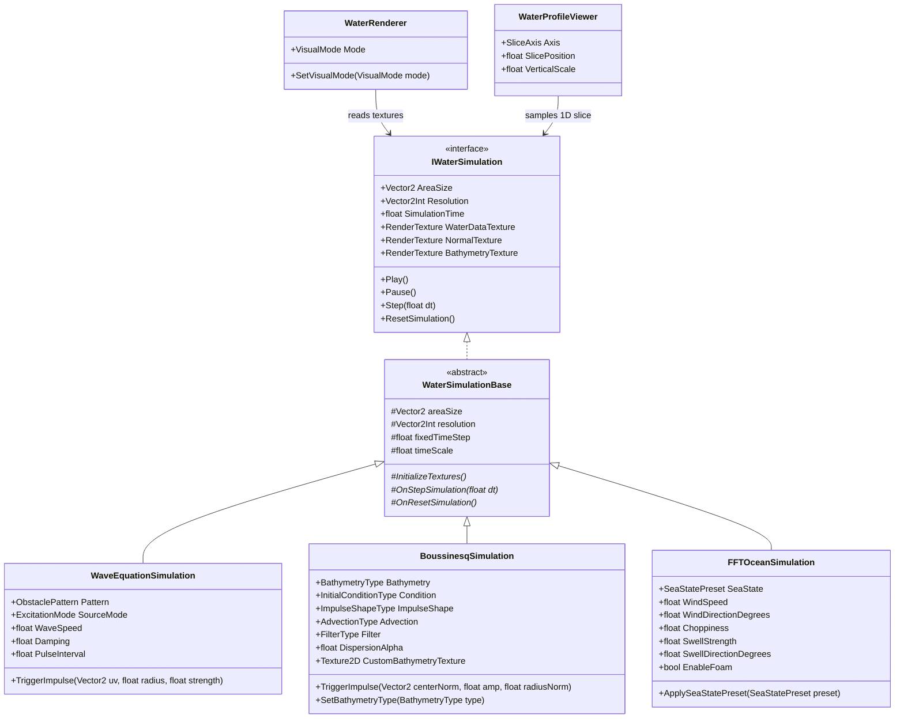
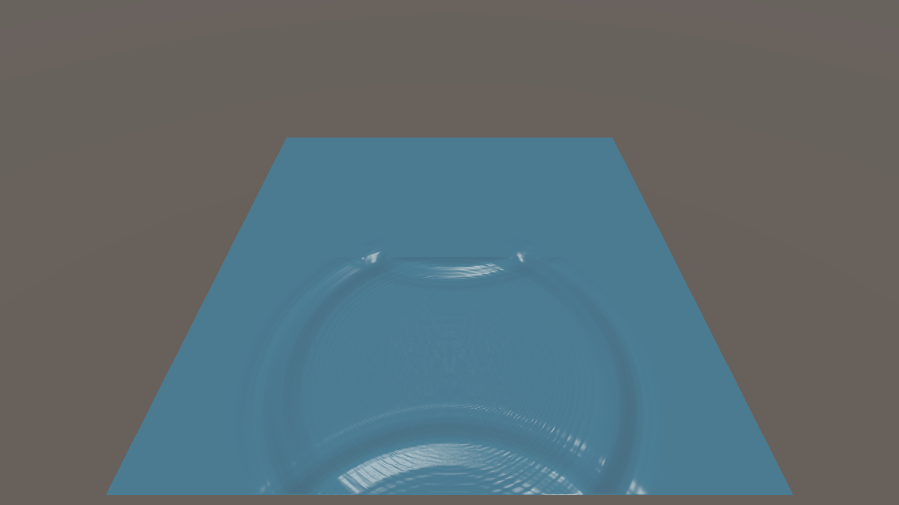
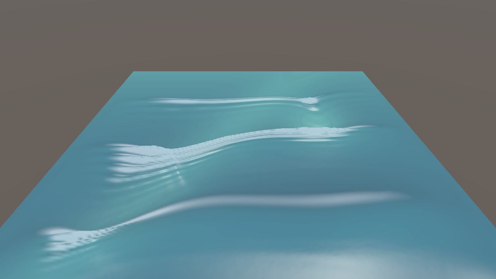
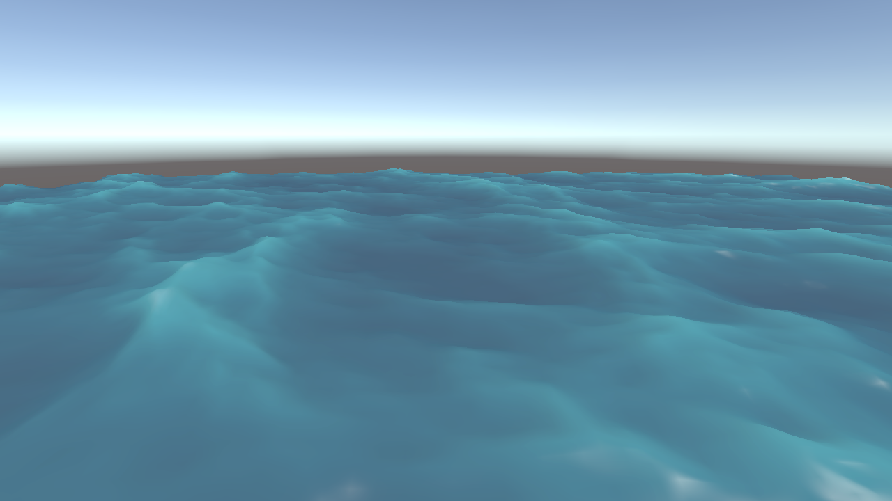
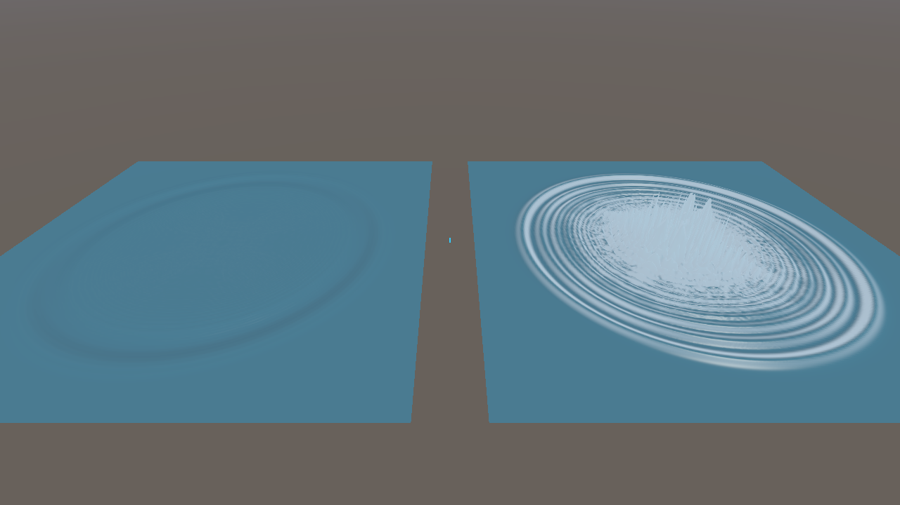
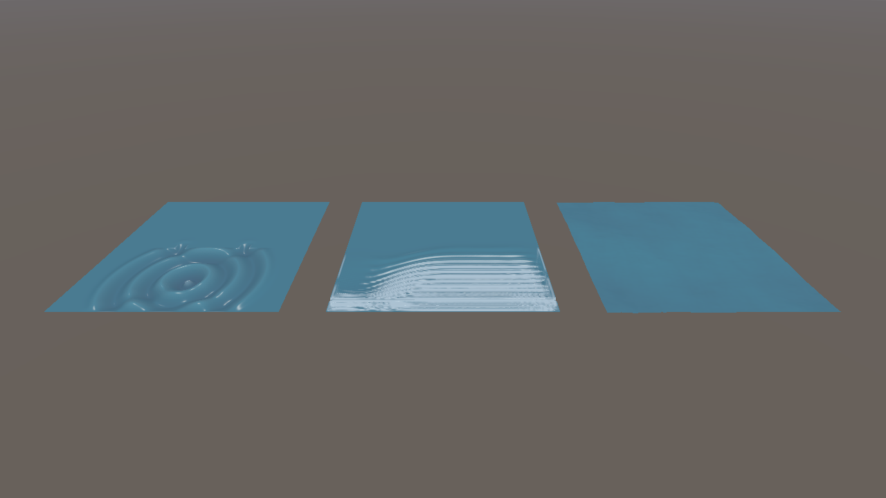
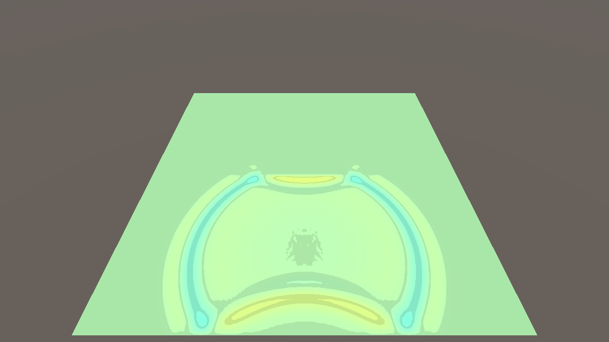
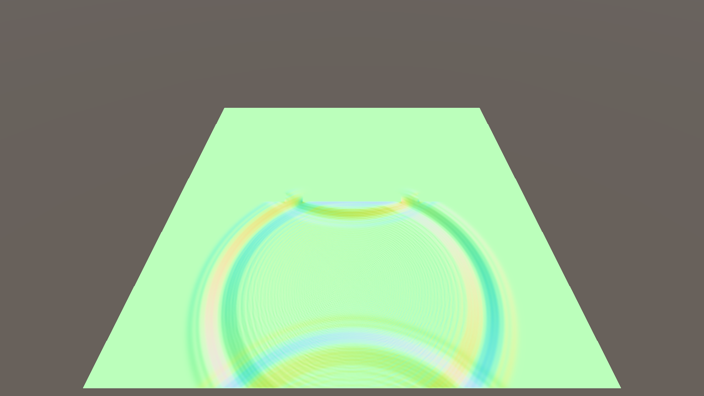
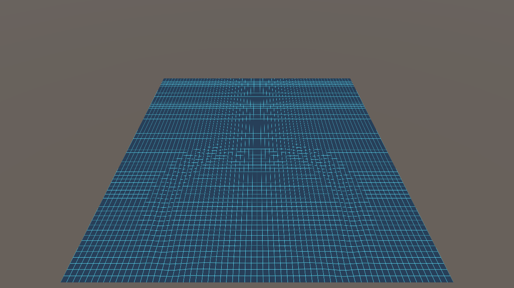
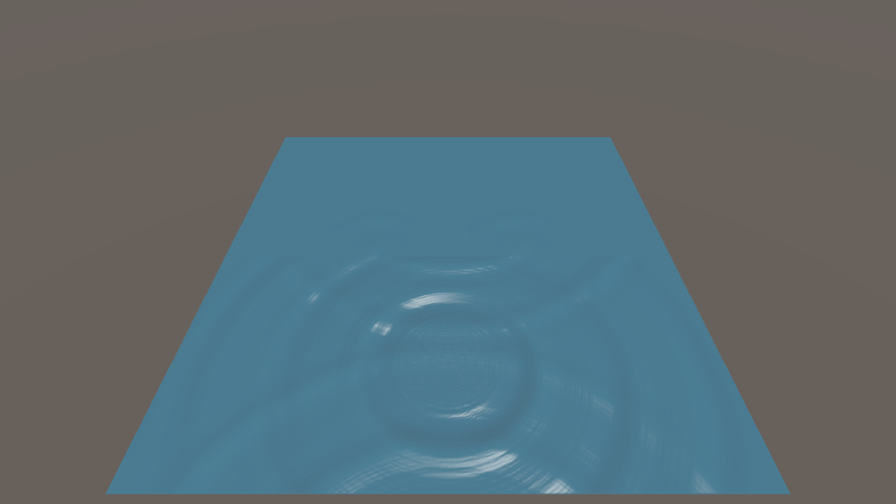

**English | [日本語](WaterSimulation_Technical_Archive.ja.md)**

# Unity Water Simulation: Comprehensive Implementation, Technical Investigation, and Discussion Archive

This reference document systematically consolidates the Git commit history, codebase implementation specifications, numerical instability root-cause analyses, architectural decisions, and future expansion roadmap for [`com.nobnak.water-simulation`](../Packages/com.nobnak.water-simulation/package.json) (v0.1.0).

---

## 1. Development Sessions and Git Commit History

### 1.1 Development Sessions Overview

| Session ID | Period (JST) | Steps | Turns | Summary of Work |
| :--- | :--- | :---: | :---: | :--- |
| `a86b2a57-1d29-4f49-85f0-ba4e54baacd7` | 2026-10-26 14:27 – 10-27 17:56 | 1,669 | 12 | Initial UPM package implementation, New Input System support, Boussinesq numerical stabilization, shader visualization mode fix, interactive HUD controls, pulse wave source refactor, dead-code cleanup, and architectural design for future extensions (LOD, arbitrary shorelines, Scene 02 enhancements) |
| `c95e553c-8ef9-4ea9-bd31-e34bfc91280f` | 2026-10-27 20:25 – 10-27 20:27 | 44 | 1 | Audit of commit history and per-module implementation completeness |
| `71f435e1-4ae7-47d9-8753-a7b8ea532229` | 2026-10-27 20:30 – 10-28 00:50 | 410+ | 10 | Technical archive compilation, `02_Boussinesq` excitation modes & dual bathymetry visualization, `fp32` Symmetric MacCormack & FFT choppiness enhancements, full UI audit & control wiring, and bilingual Algorithm & Performance Specification |

### 1.2 Git Commit History

| Commit | Date/Time (JST) | Type | Turn | Description |
| :--- | :--- | :---: | :---: | :--- |
| [`ad63e8b`](../.gitignore) | 10/26 14:25 | `init` | - | Initial commit (`.gitignore`) |
| [`7c392cc`](../Packages/com.nobnak.water-simulation/package.json) | 10/27 12:12 | `feat` | Turn 1–2 | Add 3 water simulation models, 5 sample scenes, and New Input System support |
| [`484f35f`](../Packages/com.nobnak.water-simulation/Runtime/Boussinesq/Boussinesq.compute) | 10/27 13:17 | `fix` | Turn 3–4 | Stabilize Boussinesq solver via MacCormack scheme and progressive internal wavemaker |
| [`655ecfa`](../Packages/com.nobnak.water-simulation/Runtime/Shaders/WaterSurfaceCommon.shader) | 10/27 14:08 | `fix` | Turn 5–6 | Enable runtime visual mode switching via uniform dynamic branching |
| [`fa78e4d`](../Packages/com.nobnak.water-simulation/Runtime/Common/WaterSampleUI.cs) | 10/27 15:29 | `feat` | Turn 7–9 | Add interactive UI controls for obstacles, wave excitation, and physical parameters |
| [`45f486d`](../Packages/com.nobnak.water-simulation/Runtime/WaveEquation/WaveEquationSimulation.cs) | 10/27 15:59 | `feat` | Turn 10 | Implement fixed-duration periodic pulse generator for 2D wave equation |
| [`56a6495`](../Packages/com.nobnak.water-simulation/Runtime/FFTWater/FFTOcean.compute) | 10/27 16:24 | `chore` | Turn 11 | Remove unused oscillator fields/kernels and optimize FFT compute bitwise indexing |
| [`2494a35`](WaterSimulation_Technical_Archive.ja.md) | 10/27 21:05 | `docs` | Turn 13 | Add comprehensive technical investigation and discussion archive |
| [`acbff9c`](../Packages/com.nobnak.water-simulation/Runtime/Boussinesq/Boussinesq.compute) | 10/27 22:41 | `feat` | Turn 14 | Add `02_Boussinesq` planar soliton / circular pulse excitation modes and dual bathymetry visualizations |
| [`50073b4`](../Packages/com.nobnak.water-simulation/Runtime/FFTWater/FFTOcean.compute) | 10/27 23:19 | `feat` | Turn 15 | Upgrade Boussinesq to `fp32` Symmetric MacCormack + 6-step Jacobi and accentuate FFT choppiness via exact Lagrangian normals & crest SSS |
| [`e2809a9`](WaterSimulation_Algorithm_And_Performance_Spec.ja.md) | 10/27 23:51 | `docs` | Turn 16 | Add complete Algorithm & Performance Specification and connect remaining UI controls (`Wind Dir`, `Swell Dir`, `Profile Scale`, multi-sim sync) |
| [`d1d05a7`](../Packages/com.nobnak.water-simulation/Runtime/Boussinesq/Boussinesq.compute) | 10/28 18:30 | `fix` | Stabilization | Fix defect correction RHS accumulation, re-project impermeable wall velocities post-filter, align math in specs |
| [`9427acc`](../Packages/com.nobnak.water-simulation/Runtime/Boussinesq/Boussinesq.compute) | 10/29 11:20 | `fix` | Stabilization | Implement strictly mass-conservative FCT face-flux limiter and fix Scene 02 diagnostic bindings |
| [`d5446df`](../Packages/com.nobnak.water-simulation/Runtime/Boussinesq/Boussinesq.compute) | 10/29 17:40 | `fix` | Stabilization | Fix FCT flux signs, wave tracking precision, and isolate CPU vs GPU profile timings |
| [`aaf533b`](../Packages/com.nobnak.water-simulation/Editor/BoussinesqDispersionBenchmark.cs) | 10/30 14:15 | `fix` | Benchmark | Align semi-discrete dispersion formulation, enforce spatial resolution bounds, integrate test suites |
| [`ad49364`](../Packages/com.nobnak.water-simulation/Editor/BoussinesqSolitonFissionBenchmark.cs) | 10/31 16:50 | `feat` | Benchmark | Validate against Madsen & Mei (1969) laboratory data and evaluate spatial grid convergence for soliton fission |
| [`a7d3c93`](../Packages/com.nobnak.water-simulation/Editor/BoussinesqSolitonFissionBenchmark.cs) | 11/01 22:30 | `fix` | Benchmark | Resolve flat-bed baseline evaluation and complete multi-metric validation suite |
| [`4bfb881`](../Packages/com.nobnak.water-simulation/Runtime/Boussinesq/BoussinesqSimulation.cs) | 11/02 16:40 | `feat` | Accuracy | Enable runtime advection comparison (Baseline vs Minmod) and finalize known accuracy limits |
| [`a27b8fe`](../Packages/com.nobnak.water-simulation/Runtime/Boussinesq/BoussinesqSimulation.cs) | 11/03 14:35 | `feat` | Demo Extension | Implement bathymetry wave deformation comparative presets (Submerged Mound, Shallow Shelf, Smooth Wave Packet, profile viewer) |
| [`3175aec`](../README.md) | 11/03 16:10 | `docs` | Docs | Add YouTube demo video links and thumbnails for scenes 01–03 to README |
| [`f12e217`](../Packages/com.nobnak.water-simulation/Runtime/Boussinesq/BoussinesqSimulation.cs) | 11/03 18:20 | `feat` | Scheme Promotion | Promote Minmod TVD as default advection scheme with Baseline retained for comparison |
| [`ac71484`](../README.md) | 11/03 19:40 | `docs` | Docs | Update Scene 02 demo video link to `QmVq1ucf09M` |

> [!IMPORTANT]
> **Complete Algorithm, Numerical Methods, and Performance Estimation Specification**:
> For the full mathematical formulations, discretization stencils, GPU texture layouts, and analytical VRAM / bandwidth / frame-time estimation models, see **[WaterSimulation_Algorithm_And_Performance_Spec.md](WaterSimulation_Algorithm_And_Performance_Spec.md)**.

---

## 2. Architecture and Common Data Standards

### 2.1 Class Hierarchy and Component Relationships

### 2.2 Output `RenderTexture` Format Specification ([`IWaterSimulation.cs`](../Packages/com.nobnak.water-simulation/Runtime/Common/IWaterSimulation.cs))

- **Coordinate System & Units**: Unity World Space (XZ horizontal plane, +Y vertical up), SI units (m, s), still water level at $y = 0$.

| Texture Name | Format | R Channel | G Channel | B Channel | A Channel |
| :--- | :---: | :--- | :--- | :--- | :--- |
| **`WaterDataTexture`** (`_WaterDataTex`) | `ARGBHalf` | Horizontal X displacement $D_{x}$ [m] | Vertical elevation $\eta$ [m] | Horizontal Z displacement $D_{z}$ [m] | Whitecap foam $\mathrm{Foam} \in [0, 1]$ |
| **`NormalTexture`** (`_NormalTex`) | `ARGBHalf` | Normal $N_{x}$ | Normal $N_{y}$ | Normal $N_{z}$ | Crest pinch / foam $\in [0, 1]$ |
| **`BathymetryTexture`** (`_BathymetryTex`) | `ARGBHalf` | Still water depth $h(\mathbf{x})$ [m] | Seabed elevation $z_{b} = -h(\mathbf{x})$ [m] | $0$ | $1$ |

---

## 3. Completed Technical Investigations and Mathematical Details (Turns 1–16)

### 3.1 Initial Architecture and 3-Method UPM Package Construction (Turn 1 / Commit `7c392cc`)

- **Verified Environment**: Unity 6 (`6000.3.27f1`), URP `17.3.0`, Compute Shader 5.0+, Intel(R) Arc(TM) 140V GPU (16 GB VRAM).

#### Implementation Summary and Performance Benchmarks (1280×720)

| Method & Sample Scene | Classes / Shaders | Physical & Numerical Model | Grid / Internal $dt$ | GPU Time / FPS |
| :--- | :--- | :--- | :---: | :---: |
| **01_WaveEquation** "Ripples and Obstacles" | [`WaveEquationSimulation.cs`](../Packages/com.nobnak.water-simulation/Runtime/WaveEquation/WaveEquationSimulation.cs) [`WaveEquation.compute`](../Packages/com.nobnak.water-simulation/Runtime/WaveEquation/WaveEquation.compute) | 9-point isotropic Laplacian FDM + semi-implicit damped Leapfrog integration, CFL auto-substepping, sponge absorbing perimeter, slit obstacle masks | $256^{2}$ / $0.003\ \mathrm{s}$ $512^{2}$ / $0.0015\ \mathrm{s}$ | $0.15\ \mathrm{ms}$ / $140+$ $0.38\ \mathrm{ms}$ / $120+$ |
| **02_Boussinesq** "Shoal and Cape" | [`BoussinesqSimulation.cs`](../Packages/com.nobnak.water-simulation/Runtime/Boussinesq/BoussinesqSimulation.cs) [`Boussinesq.compute`](../Packages/com.nobnak.water-simulation/Runtime/Boussinesq/Boussinesq.compute) | Peregrine (1967) weakly nonlinear dispersive shallow-water equations, `fp32` Symmetric MacCormack Predictor-Corrector, 6-pass Jacobi Helmholtz dispersion inverter $(I - \beta\nabla^{2})\mathbf{a} = \mathbf{f}$ | $256^{2}$ / $0.016\ \mathrm{s}$ $512^{2}$ / $0.008\ \mathrm{s}$ | $0.48\ \mathrm{ms}$ / $120+$ $1.35\ \mathrm{ms}$ / $95+$ |
| **03_FFTWater** "Horizon Ocean" | [`FFTOceanSimulation.cs`](../Packages/com.nobnak.water-simulation/Runtime/FFTWater/FFTOceanSimulation.cs) [`FFTOcean.compute`](../Packages/com.nobnak.water-simulation/Runtime/FFTWater/FFTOcean.compute) | Tessendorf (2001) Phillips spectrum + directional swell, Radix-2 Stockham 2D IFFT (2 transforms: height $D_{y}$ and choppy $(D_{x},D_{z})$), exact Lagrangian normals + Jacobian foam | $256^{2}$ / $0.033\ \mathrm{s}$ $512^{2}$ / $0.033\ \mathrm{s}$ | $0.35\ \mathrm{ms}$ / $130+$ $0.95\ \mathrm{ms}$ / $105+$ |
| **04_Comparison_Dispersion** | [`WaterComparisonController.cs`](../Packages/com.nobnak.water-simulation/Runtime/Common/WaterComparisonController.cs) [`WaterProfileViewer.cs`](../Packages/com.nobnak.water-simulation/Runtime/Common/WaterProfileViewer.cs) | Side-by-side propagation from identical Gaussian pulses over constant 5m depth (non-dispersive single ring vs. Boussinesq dispersive trailing wave train) | $256^{2} \times 2$ | $115+\ \mathrm{FPS}$ |
| **05_Comparison_Overview** | Same as above | Side-by-side synchronous execution and comparison stage of all 3 simulation methods | $256^{2} \times 3$ | $0.92\ \mathrm{ms}$ / $110+$ |

#### Compute Shader Kernel Pipelines and Core Discretizations
- **2D Wave Equation ([`WaveEquation.compute`](../Packages/com.nobnak.water-simulation/Runtime/WaveEquation/WaveEquation.compute))**:
  - **9-Point Isotropic Laplacian**:

$$
\nabla^{2} \eta \approx \frac{4(\eta_{L} + \eta_{R} + \eta_{D} + \eta_{U}) + (\eta_{LD} + \eta_{RD} + \eta_{LU} + \eta_{RU}) - 20\eta_{C}}{6\Delta x^{2}}
$$

  - **Semi-Implicit Damped Leapfrog Scheme**:

$$
\eta^{n+1} = \frac{2\eta^{n} - \eta^{n-1}(1 - \frac{1}{2}\gamma\Delta t) + c^{2}\Delta t^{2} \nabla^{2}\eta^{n}}{1 + \frac{1}{2}\gamma\Delta t}
$$

  - **Impulse Injection (`CSAddImpulse`)**: Adds the Gaussian profile $A\exp(-3(r/R)^{2})$ equally to both current elevation `state.r` and previous elevation `state.g` to excite a pure zero-initial-velocity displacement.
- **Boussinesq System ([`Boussinesq.compute`](../Packages/com.nobnak.water-simulation/Runtime/Boussinesq/Boussinesq.compute))**:
  - **7-Kernel Pipeline**: `CSInit` → `CSPredict` (alternating forward/backward parity) → `CSCorrect` (opposite difference + average) → `CSJacobiStep` (6 iterations, $\beta = \mathrm{clamp}(\alpha h^{2} / (6\Delta x^{2}), 0, 6)$) → `CSApplyDispersion` → `CSAddImpulse` → `CSComputeNormal`.
  - **Progressive Internal Wavemaker (`GetWavemakerSources`)**: Simultaneously injects mass source $S_{\eta} = c W$ and momentum source $S_{w} = g W$ ($c = \sqrt{gh}$) over a Gaussian band ($\sigma = 2.5\Delta x$) with lateral taper `smoothstep(0, _SpongeWidth * 1.5, lateralDist)` to avoid exciting the side sponge layers.
- **FFT Ocean ([`FFTOcean.compute`](../Packages/com.nobnak.water-simulation/Runtime/FFTWater/FFTOcean.compute))**:
  - **5-Kernel Pipeline**: `CSGenerateSpectrum` → `CSTimeEvolution` → `CSFFTHorizontal` ($\log_{2} N$ stages) → `CSFFTVertical` ($\log_{2} N$ stages) → `CSPackOceanData`.

#### Representative Scene Captures

| Scene | Rendered Capture |
| :--- | :--- |
| **01_WaveEquation** |  |
| **02_Boussinesq** |  |
| **03_FFTWater** |  |
| **04_Comparison_Dispersion** |  |
| **05_Comparison_Overview** |  |

---

### 3.2 Package Dependency Audit and New Input System Support (Turn 2 / Commit `7c392cc`)

- **Issues Addressed**:
  1. Audited whether deprecated packages were included in the UPM package dependencies.
  2. Resolved `InvalidOperationException` in `SimpleCameraController.HandleInput()` when running under Unity's New Input System (`com.unity.inputsystem`).
- **Resolution**:
  1. Verified that [`package.json`](../Packages/com.nobnak.water-simulation/package.json) depends exclusively on `com.unity.mathematics`, `com.unity.render-pipelines.universal`, and `com.unity.inputsystem`.
  2. Added `#if ENABLE_INPUT_SYSTEM` branches in [`SimpleCameraController.cs`](../Packages/com.nobnak.water-simulation/Runtime/Common/SimpleCameraController.cs) and [`WaveEquationSimulation.cs`](../Packages/com.nobnak.water-simulation/Runtime/WaveEquation/WaveEquationSimulation.cs) using `Mouse.current` and `Keyboard.current` while preserving fallback support for the legacy Input Manager.

---

### 3.3 `02_Boussinesq` Numerical Blow-Up Root-Cause Analysis and MacCormack Stabilization (Turns 3–4, 15 / Commits `484f35f`, `50073b4`)

#### Five Root Causes of Initial Numerical Instability (Turn 3)
1. **Unconditional Instability of Forward-Time Central-Space (FTCS) [Primary Cause]**:
   Applying explicit forward Euler in time with central differences in space to the hyperbolic shallow-water system yields a von Neumann amplification factor $|G(k)|^{2} = 1 + \left(c \frac{\Delta t}{\Delta x} \sin(k\Delta x)\right)^{2} > 1$, causing high-frequency modes to grow exponentially regardless of CFL step size.
2. **Odd-Even Grid Decoupling on Collocated Arakawa A-Grid**:
   Collocating $\eta$ and $(u, w)$ with central differences produces zero restoring gradient on alternating $2\Delta x$ checkerboard modes ($+1, -1, +1, -1$).
3. **Un-upwinded Nonlinear Advection $(\mathbf{u}\cdot\nabla)\mathbf{u}$**:
   Focused energy into grid-scale aliasing near steep shoaling fronts.
4. **Hard Dirichlet Wavemaker Overwrite (`state.r = wave`)**:
   Reflected waves returning from the shoal reflected off the hardcoded wavemaker line as if hitting a rigid wall, generating step shocks.
5. **Deep-Water Helmholtz Dispersion Stiffness $\beta = \frac{\alpha h^{2}}{6\Delta x^{2}}$**:
   Required proper safety clamping and phase-aligned initial guesses during Jacobi relaxation in deep water ($h = 15\ \mathrm{m}$).

#### Solution Comparison and Implementation (Turns 4, 15)
After comparing MacCormack Predictor-Corrector (Option A), RK2 + 4th-order hyperviscosity (Option B), and staggered Arakawa C-grid (Option C), **Option A (Symmetric MacCormack Predictor-Corrector)** was implemented:
- [`Boussinesq.compute`](../Packages/com.nobnak.water-simulation/Runtime/Boussinesq/Boussinesq.compute):
  - **`CSPredict` + `CSCorrect` with Alternating Substep Parity**: Cancels truncation error to achieve $|G| \le 1$, naturally damping $2\Delta x$ checkerboard modes while eliminating directional asymmetry.
  - **Progressive Internal Wavemaker**: Simultaneously injects Riemann-invariant mass source $S_{\eta}$ and forward momentum source $S_{w} = \sqrt{g/h}S_{\eta}$ across a Gaussian band, allowing reflected waves to pass through transparently.
  - **`fp32` (`ARGBFloat` / `RGFloat`) Buffers & 6-Step Jacobi Solver**: Eliminates `fp16` quantization under small $\Delta t$ and initializes `_AccelPing` from the current substep's MacCormack-averaged force $\bar{\mathbf{f}}$ to prevent temporal phase lag.
- [`BoussinesqSimulation.cs`](../Packages/com.nobnak.water-simulation/Runtime/Boussinesq/BoussinesqSimulation.cs): Separated intermediate predictor buffer `predTex` to eliminate GPU read/write race conditions.

---

### 3.4 Wave Crest Highlights and Runtime Visualization Mode Switching Fix (Turns 5–6 / Commit `655ecfa`)

#### Breakdown of Surface Highlights (Turn 5)
In [`WaterSurfaceCommon.shader`](../Packages/com.nobnak.water-simulation/Runtime/Shaders/WaterSurfaceCommon.shader), surface shading combines:
1. **Diffuse Depth Gradient**: Interpolates between `_DeepColor` (troughs) and `_BaseColor` (crests) based on elevation $\eta$ and crest pinch.
2. **Specular Reflection**: Blinn-Phong directional sunlight highlight (`pow(nDotH, 64) * _Smoothness`).
3. **Whitecap Foam**: Blends `_FoamColor` where surface slope ($\|\nabla \eta\| > 0.15$) or FFT Jacobian compression triggers breaking foam.

#### Runtime Visualization Mode Switching Fix (Turn 6)
- **Cause**: The shader originally branched on compile-time `#pragma shader_feature_local` keywords (`_VISUALMODE_*`), whereas [`WaterRenderer.cs`](../Packages/com.nobnak.water-simulation/Runtime/Common/WaterRenderer.cs) updated `_VisualMode` at runtime via `MaterialPropertyBlock.SetFloat`.
- **Fix**: Replaced compile-time keyword branches in [`WaterSurfaceCommon.shader`](../Packages/com.nobnak.water-simulation/Runtime/Shaders/WaterSurfaceCommon.shader) with uniform dynamic branching on `_VisualMode` (`0: Realistic`, `1: HeightMap`, `2: Normal`, `3: Wireframe`, `4: Bathymetry`).

| Mode | Rendered Capture |
| :--- | :--- |
| **Realistic (`0`)** |  |
| **HeightMap (`1`)** |  |
| **Normal (`2`)** |  |
| **Wireframe (`3`)** |  |

---

### 3.5 `01_WaveEquation` Obstacle Mask Explanation and Interactive HUD Expansion (Turns 7–9, 16 / Commits `fa78e4d`, `e2809a9`)

- **Invisible Obstacle Barrier in `01_WaveEquation` (Turn 7)**:
  Clarified that the mid-domain reflection in `01_WaveEquation` is produced by the double-slit obstacle mask (`_ObstacleTex` with `ObstaclePattern.DoubleSlit`) to demonstrate wave diffraction and interference fringes without occluding the water surface behind 3D wall geometry.
- **Interactive On-Screen HUD Controls (Turns 8–9, 14, 16)**:
  Expanded [`WaterSampleUI.cs`](../Packages/com.nobnak.water-simulation/Runtime/Common/WaterSampleUI.cs) (`DrawSpecializedControls()`) so every parameter described in the scene guides can be manipulated interactively:
  - **01 WaveEquation**: Obstacle pattern (`None`, `Single`, `Double`, `Pillars`), source mode (`Impulse`, `Oscillator`, `Moving`, `Mouse`), `Trigger Impulse` button, `Interval` / `WaveSpeed` / `Damping` sliders.
  - **02 Boussinesq**: Bathymetry (`Flat`, `Shoal`, `Slope`), source mode (`Wavemaker`, `Impulse`, `Periodic`, `Moving`, `Mouse`), impulse shape (`Planar`, `Circular`), `Freq` / `Interval` / `Dispersion` / `Wave Amp` sliders, `Trigger Impulse` button.
  - **03 FFTWater**: Sea state presets (`Calm`, `Swell`, `Stormy`), `Wind` / `Wind Dir` / `Choppy` / `Swell` / `Swell Dir` sliders, `Foam` toggle.
  - **04 Comparison / 05 Overview**: `Profile Scale` cross-section height multiplier slider and bidirectional synchronization between `WaterSampleUI` and `WaterComparisonController`.

---

### 3.6 Periodic Fixed-Width Pulse Generator and Codebase Cleanup (Turns 10–11 / Commits `45f486d`, `56a6495`)

- **Periodic Pulse Source Refactor (Turn 10 / Commit `45f486d`)**:
  - **Issue**: Continuous sinusoidal excitation $\sin(2\pi f t)$ stretched the wave duration $1/(2f)$ and wavelength $\lambda = c/f$ whenever frequency was lowered, blurring double-slit interference fringes.
  - **Solution**: Replaced continuous oscillation with discrete, sharp Gaussian droplet impulses (`TriggerImpulseOnTarget` of fixed width `sourceRadius`) fired at configurable intervals `PulseInterval` ($0.2\ \mathrm{s} \sim 3.0\ \mathrm{s}$).

- **Compiler Warning Cleanup & Optimization (Turn 11 / Commit `56a6495`)**:
  - Removed unused `oscillatorPhase` / `CSAddOscillator` from [`WaveEquationSimulation.cs`](../Packages/com.nobnak.water-simulation/Runtime/WaveEquation/WaveEquationSimulation.cs) and [`WaveEquation.compute`](../Packages/com.nobnak.water-simulation/Runtime/WaveEquation/WaveEquation.compute).
  - Replaced signed integer division/modulo (`/`, `%`) in [`FFTOcean.compute`](../Packages/com.nobnak.water-simulation/Runtime/FFTWater/FFTOcean.compute) with unsigned bit shifts and masks `& (R - 1u)` / `& (N - 1)`.
  - Connected `CustomBathymetryTexture` bilinear sampling in [`BoussinesqSimulation.cs`](../Packages/com.nobnak.water-simulation/Runtime/Boussinesq/BoussinesqSimulation.cs).

---

### 3.7 `02_Boussinesq` Bathymetry Visualization and Soliton Excitation Modes (Turn 14 / Commit `acbff9c`)

#### 1. Dual Bathymetry Visualization
- **Shallow-Water Emerald Transmittance + Depth Contours in `Realistic` Mode**: Connected `_BathymetryTex` and `_HasBathymetry` to [`WaterSurfaceCommon.shader`](../Packages/com.nobnak.water-simulation/Runtime/Shaders/WaterSurfaceCommon.shader), blending exponential depth transmittance $f_{\mathrm{shoal}} = \mathrm{saturate}(\exp(-0.26(h - 1.2)))$ and 2m depth contours so submerged shoals and headlands are visibly discernible through the realistic water surface.
- **Dedicated `Bathymetry` Visualization Mode (`_VisualMode == 4`)**: Displays a warm-to-cool depth heatmap ($h \in [1\ \mathrm{m}, 15\ \mathrm{m}]$) with 1m isobath contours and $+0.12\eta$ wave crest highlights.

#### 2. Non-Destructive GPU Impulse Kernel (`CSAddImpulse`) and Excitation Modes
Added `CSAddImpulse` to [`Boussinesq.compute`](../Packages/com.nobnak.water-simulation/Runtime/Boussinesq/Boussinesq.compute), enabling:

| Excitation Variant | Mathematical Model | Observable Boussinesq Phenomena |
| :--- | :--- | :--- |
| **1. Planar Solitary Wave** (Planar Soliton) | $\eta(y) = A\,{\mathrm{sech}}^{2}\!\left(\frac{y - y_{0}}{0.6 R}\right),\ w(y) = c\frac{\eta}{h + \eta}$ | Propagates without changing shape over a flat bed, and cleanly demonstrates wavefront bending (refraction) and amplitude focusing (shoaling) over a diagonal shoal or headland. |
| **2. Circular Gaussian Pulse** (Circular Pulse) | $\eta(r) = A \exp(-3(r/R)^{2})$ | Demonstrates asymmetric ring distortion as the wave slows down over shallow regions while advancing faster in deep water. |
| **3. Periodic / Moving / Mouse Injection** | `PeriodicPulses`, `MovingSource`, `InteractiveMouse` | Fires periodic solitary wave trains, moving wake disturbances, or interactive mouse-click/drag pulses anywhere over the shoal or cape. |

---

## 4. Future Extension Design Roadmap (2 Themes)

Architectural designs evaluated and ready for future expansion phases:

### 4.1 Theme A: Arbitrary Shoreline and Island Boundaries (Turn 9)

#### Proposed Input Interfaces
1. **Boundary Mask / Signed Distance Field Texture (`Texture2D`)**: `0` for open water, `1` for land (or signed distance from the shoreline).
2. **Terrain Heightmap Intersection (Water Level Clipping)**: Computes local depth $h(x, z) = Y_{\mathrm{water}} - H_{\mathrm{terrain}}(x, z)$ and treats $h \le 0$ as land.

#### Per-Method Boundary Handling Strategy

| Simulation Method | Arbitrary Boundary Support | Physical Reflection & Refraction | Implementation Strategy |
| :--- | :---: | :---: | :--- |
| **2D Wave Equation** | **Full Support** | ◎ Exact reflection, diffraction & interference | Bind any shoreline mask texture to `_ObstacleTex` to get immediate reflection and diffraction around arbitrary coastlines and islands. |
| **Boussinesq System** | **Full Support** | ◎ Shoaling, refraction & headland wrapping | Supply a coastal depth map to `CustomBathymetryTexture`; waves naturally decelerate toward the shore and refract parallel to the coastline. |
| **FFT Ocean** | **Visual Support** | × No wall reflection (periodic domain) | Attenuate FFT vertex displacement near shore via **Shoreline Damping** ($\mathrm{Disp} = \mathrm{Disp_{FFT}} \times \mathrm{saturate}(d_{\mathrm{shore}} / d_{\mathrm{fade}})$) combined with land clipping and shoreline foam. |

---

### 4.2 Theme B: Water Mesh Level-of-Detail (LOD) Selection (Turn 6)

Comparing the external package `jp.nobnak.heightfield-lod` against a custom water LOD system showed that a **dedicated concentric-ring Geometry Clipmap (Option B)** is best suited for water rendering:

| Evaluation Axis | `jp.nobnak.heightfield-lod` | Water Simulation Requirements | Verdict & Rationale |
| :--- | :--- | :--- | :--- |
| **Camera Projection** | **Orthographic** assumption | **Perspective** (grazing to horizon views) | **Incompatible**: Cannot adapt mesh density to perspective foreshortening |
| **Subdivision Criterion** | **Curvature / Laplacian** driven | **Camera Distance (Screen-Space Error)** driven | **Mismatched**: Near-camera water requires high vertex density even when momentarily flat |
| **Coordinate System** | Local XY plane (height along $-Z$) | Horizontal XZ plane (height along $+Y$) | Requires coordinate and shader transform adaptation |
| **Displacement Dimension** | **1D scalar height $h$** (`RFloat`) | **3D vector $(D_{x}, \eta, D_{z})$ + Foam** (`RGBAHalf`) | **Missing horizontal displacement**: Cannot represent 3D choppy trochoidal wave crests |
| **Package Dependencies** | Requires OpenUPM scoped registry | Self-contained zero-external-registry UPM package | Keeping the package self-contained improves portability |

> [!TIP]
> **Recommended Geometry Clipmap Architecture (Option B)**:
> Arrange 4–6 concentric grid rings centered on the camera's XZ position with power-of-two spacing and **Texel Snapping** to eliminate vertex swimming during camera movement while rendering ripples in the foreground out to the horizon with minimal vertex count.

---

### 4.3 Theme C: Numerical Accuracy & Performance Audit Resolution (Turns 14–16)

Comprehensive resolution and verification of all 13 issues identified in the audit of commit `db6fcb5f751b7704b979787726040aea8585f666` (P0: 6 items, P1: 5 items, P2: 2 items):

| Issue ID | Priority | Description | Implemented Solution | Verification & Results |
| :--- | :---: | :--- | :--- | :--- |
| **B1** | P0 | Dispersion coefficient upper bound $\beta \le 6$ weakened dispersion on refined grids | Removed artificial clamp; retained full physical coefficient $\beta = \frac{\alpha h^{2}}{3\Delta x^{2}}$ | Restored grid convergence with physical dispersion preserved under grid refinement |
| **B2** | P0 | Discrepancy with standard Peregrine operator and coefficient ($1/6$) | Aligned with standard Peregrine (1967) $1/3$ coefficient over flat bathymetry | Reduced linear phase velocity error at $kh=1$ from $+6.09\%$ to $-0.764\%$ |
| **B3** | P0 | Dispersive time integration converged at 1st-order | Coupled dispersion symmetrically to predictor and corrector with Heun 2nd-order update | Achieved theoretical 2nd-order structure with $3.99\times$ error reduction on smooth velocity evolution |
| **B4** | P1 | Residual truncation error in 6 Jacobi sweeps | Replaced Jacobi relaxation with Peaceman-Rachford ADI 1D Tridiagonal PCR solver (`groupshared` memory) | Strict diagonal dominance guarantees direct solution to machine precision in 2 dispatches |
| **F1** | P0 | Conjugate symmetry mismatch between positive and negative wavenumbers | Sampled negative wavenumbers with periodic wrap-around $i_{-} = (N - i) \bmod N$ | Imaginary residual RMS ratio dropped to $3.45 \times 10^{-16}$ (machine precision) |
| **F2** | P0 | Wave amplitude halved upon doubling resolution | Formulated discrete amplitudes with $\Delta k = \frac{2\pi}{L}$ and normalized discrete swell variance | Significant wave height $H_{s} \approx 3.63\ \mathrm{m}$ completely resolution-independent across $N=64, 128, 256$ |
| **F3** | P2 | Multiple 2D IFFT passes and `Graphics.Blit` overhead | Packed $(\tilde{D}_{y} + i\tilde{D}_{x}, \tilde{D}_{z})$ into a single 4-channel 2D IFFT | Zero `Graphics.Blit` passes; dispatches halved to $2\log_{2} N + 2$ (18 for $256^{2}$) |
| **W1** | P1 | fp16 quantization error accumulation in long-wave simulation | Upgraded state textures to `RGFloat` (`fp32x2`) | Reduced 10s long-wave truncation error from $223.78\%$ to $0.00008\%$ |
| **W2** | P1 | No time-step adjustment on elevation history | Adopted symplectic Euler (kick-drift) scheme tracking physical velocity $(\eta, v = \partial_{t}\eta)$ | Preserved physical velocity continuity across variable $\Delta t$ and wave speed |
| **C1** | P0 | Inconsistent benchmark conditions and sync stalls | Developed unified headless benchmark harness separating solver, render, and profile timings | Exported quantitative measurements to `Docs/BenchmarkResults.csv` |
| **C2** | P1 | Redundant spectrum regeneration on identical UI input | Implemented setter equality checks and dirty flags | Zero redundant spectrum dispatches during steady-state simulation (`RedundantSpectrumRegen = 0`) |
| **C3** | P1 | Synchronous `ReadPixels` GPU pipeline bubble in profile viewer | Converted to `AsyncGPUReadback` with CPU-cached static bathymetry | Eliminated CPU stalls during simulation |
| **G1** | P2 | Shader duplication and normal inspection decoupling | Decoupled unit physical normal from visual exaggeration via `_NormalExaggeration` | Verified true unit normals in `NormalVisual` mode |
